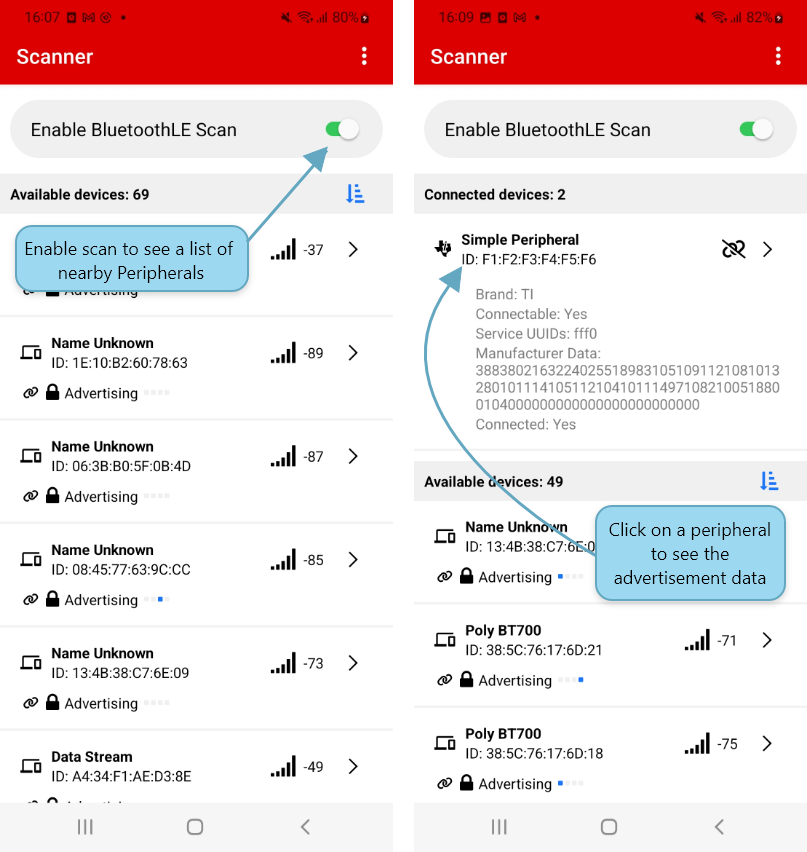

# SimpleLink Connect App

Texas Instruments React Native application designed to connect, scan, and manage Bluetooth Low Energy (BLE) devices on Android and iOS platforms.  
Features include device scanning, filtering, connecting, and managing device configurations with an intuitive UI.


---

## Table of Contents

- [Prerequisites](#prerequisites)  
- [Setup](#setup)  
- [Install Node Packages](#install-node-packages)  
- [Configure and Run Android App](#configure-and-run-android-app)  
- [Configure and Run iOS App](#configure-and-run-ios-app)  

---

## Prerequisites

Before setting up the project, ensure you have the following installed:

- **VS Code**  
  [https://code.visualstudio.com/download](https://code.visualstudio.com/download)  

- **Android Studio**  
  [https://developer.android.com/studio](https://developer.android.com/studio)  

- **Xcode**  
  Download from the Mac App Store  

- **Java 17**  
  [https://download.oracle.com/java/17/archive/jdk-17.0.8_macos-x64_bin.dmg](https://download.oracle.com/java/17/archive/jdk-17.0.8_macos-x64_bin.dmg)  

- **Node.js LTS (v22.14.0)**  
  [https://nodejs.org/en](https://nodejs.org/en)  

- **Homebrew (v4.4.17)**  
  [https://github.com/Homebrew/brew/releases/download/4.4.17/Homebrew-4.4.17.pkg](https://github.com/Homebrew/brew/releases/download/4.4.17/Homebrew-4.4.17.pkg)  

### Homebrew Setup with Proxy (if applicable)

```bash
export http_proxy="<your-proxy>"
export https_proxy="<your-proxy>"
/bin/bash -c "$(curl -fsSL https://raw.githubusercontent.com/Homebrew/install/HEAD/install.sh)"
brew install android-platform-tools
brew install cocoapods
```

### Installing adb (Android Debug Bridge)
1. Download SDK Platform-Tools for Mac from:
https://developer.android.com/studio/releases/platform-tools.html
2. Open Terminal and run:
  ```bash
  cd ~/Downloads/
  unzip platform-tools-latest*.zip
  mkdir ~/.android-sdk-macosx
  mv platform-tools/ ~/.android-sdk-macosx/platform-tools
  echo 'export PATH=$PATH:~/.android-sdk-macosx/platform-tools/' >> ~/.zshrc
  source ~/.zshrc
  adb devices
  ```

### Configure ANDROID_HOME environment variable
Edit your shell profile (~/.zshrc or equivalent):
```bash
nano ~/.zshrc
```
Add these lines (replace {YourName} with your macOS username):
```bash
export ANDROID_HOME=/Users/{YourName}/Library/Android/sdk
export PATH=$ANDROID_HOME/platform-tools:$PATH
export PATH=$ANDROID_HOME/tools:$PATH
export PATH=$ANDROID_HOME/tools/bin:$PATH
```
Save and exit (Ctrl+X, then Y, then Enter), then restart the terminal and verify:
``` bash
echo $ANDROID_HOME 
```

### Proxy Setup for Gradle and npm (if required)
* Gradle proxy: Add to android/gradle.properties
```
systemProp.http.proxyHost=<your-proxy>
systemProp.http.proxyPort=<port>
systemProp.https.proxyHost=<your-proxy>
systemProp.https.proxyPort=<port>
```
* npm proxy:
```bash
npm config set proxy http://<your-proxy>:<port>
npm config set https-proxy http://<your-proxy>:<port>
```


## Setup
Follow React Native official environment setup:
https://reactnative.dev/docs/environment-setup


## Install Node Packages
From the project root, run:
```bash
npm install
```

## Configure and Run Android App
### Setup Android Phone
Enable ADB debugging on your Android device:
https://developer.android.com/studio/debug/dev-options
### Run on Android Device
Connect your phone via USB and run:
```bash
adb devices
adb reverse tcp:8081 tcp:8081
npm run android
```

## Configure and Run iOS App

### Set Signing Certificate in Xcode
1. Open the project in Xcode.
2. Select your project SimpleLink Connect in the left sidebar.
3. Navigate to the Signing & Capabilities tab.
4. Set your team and signing certificates accordingly.

### Install CocoaPods (only once)
```bash
cd ios
pod install
```
### Install React Native CLI tools (only once)
```bash
npm install -g react-native
npm install -g ios-deploy
```
## Build and Run on iOS Device
Make sure your iPhone is connected via USB and on the same WiFi network, then run:
```bash
npx react-native run-ios --device "Name of iPhone"
```